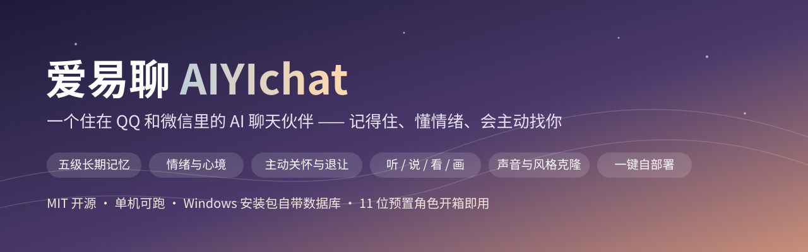

<p align="center">
  <strong>中文</strong> · <a href="README_en.md">English</a>
</p>

<p align="center">
  
</p>

<p align="center">
  <a href="https://github.com/BugWhispererChen/AIYIchat/releases/tag/v1.0"></a>
  <a href="LICENSE"></a>
  <a href="https://www.python.org/"></a>
  <a href=".github/workflows/ci.yml"></a>
  <a href="https://github.com/BugWhispererChen/AIYIchat/stargazers"></a>
</p>

# 爱易聊（AIYIchat）

> 一个住在 QQ 和微信里的 AI 聊天伙伴——**记得住你说过的话、读得懂你的情绪、会主动来找你**，
> 能听你发的语音、看你拍的照片、用你复刻的声音回你、按气氛甩表情包，
> 也可以是 11 位预置陪伴角色，或你自己造出来的那一个。

**不用下载任何 App**：在 QQ 或微信里加个好友，对话就开始了。
**不用一支团队**：MIT 开源，一个人、一台机器就能跑起来——Windows 是双击安装的单文件（数据库都自带），
Linux 是一行脚本，装完就有 11 位角色和全套表情包可以直接开聊。

> 市面上大多数 AI 陪伴产品把力气花在"模型更强"上。爱易聊赌的是另一件事：
> **陪伴感来自模型之外的那一层层细节**——记忆怎么留住、情绪怎么接住、什么时候该主动、
> 什么时候该闭嘴、一条回复该拆成几条发。
> 如果这套思路你觉得有点意思，**点个 Star 就是对这个项目最直接的支持**。

---

## 30 秒感受一下

下面是一段**示意对话**（为说明能力而写，非真实用户记录），展示的是"同一句话，有记忆和没记忆的区别"：

```text
对方    今天面完了，感觉凉了
AI      啊，那家你准备了两星期的？
AI      先别急着判自己死刑，哪一步觉得卡住了？
对方    最后那个项目细节没答上来
AI      那个项目你上周不是还跟我讲过数据流怎么设计的吗
AI      面试的时候脑子空白太正常了，不代表你没准备好
AI      （语音 0:04）
AI      [表情：拍肩.gif]
AI      晚上别想这事了，去吃点热的，回来跟我骂两句也行
```

这里同时发生了四件事：**接住情绪先于分析**、**翻出上周的细节**、**改用语音**、**按气氛甩表情**。
下面把它们拆开讲。

---

## 目录

1. [亮点速览](#亮点速览)
2. [它哪里不一样（创新点）](#一它哪里不一样创新点)
3. [值得选它的理由（优势点）](#二值得选它的理由优势点)
4. [快速开始（V1.0 部署包）](#三快速开始v10-部署包)
5. [参与贡献](#参与贡献)
6. [合规与责任](#合规与责任)
7. [素材版权](#素材版权)
8. [路线图](#路线图)
9. [免责声明](#免责声明)
10. [安全披露](#安全披露)
11. [许可证](#许可证)

---

## 亮点速览

| 你会得到 | 具体是什么 |
|---|---|
| **零安装** | QQ / 微信加好友即聊，不用装新 App；两个平台一套系统，多 Bot 多账号同时在线 |
| **真记得** | 五级记忆：沉淀 → 语义检索 → 治理去重 → 反思归纳 → 人际脉络，上周提的小事今天还在 |
| **有分寸的主动** | 会在合适的时机先找你，被忽略就自己收着；勿扰时段可配，角色还有自己的作息 |
| **像人，不像模型** | 发送前的确定性"AI 腔"门禁、按真人节奏分条、能一句话说完绝不写三段 |
| **四感齐全** | 听得懂语音、看得懂照片、用预置或你复刻的音色回语音、按语境给你画一张 |
| **角色随便换** | 11 位预置陪伴角色 + 后台向导自建 + 导入本人聊天记录与音频做克隆（文字像、声音也像） |
| **质量可量化** | 离线评测体系：模型评审 + 确定性指标 + A/B 成对比较，改得好不好有数，不靠感觉 |
| **一个人也养得起** | 单机部署，Windows 安装包自带数据库与音频工具链；改配置热生效，不用重启 |
| **可自营可开站** | C 端网页自助注册 / 渠道 / 服务 / 账号中心一整套，默认关闭，不影响既有链路 |

---

## 一、它哪里不一样（创新点）

### 1. 记忆：五级递进，而不只是"塞上下文"

普通聊天机器人聊过就忘。爱易聊把记忆做成一条可以逐级审视的链路，每一级都能单独开关、单独评测：

| 层级 | 它在做什么 | 你能感觉到什么 |
|---|---|---|
| **① 沉淀** | 历史消息窗口 + 对话变长时自动摘要，把关键信息写成事实 | "上周随口提的那件小事，它今天还记得" |
| **② 检索与分层注入** | 稳定事实留在系统提示词前缀以命中缓存，本轮语义召回的结果后置注入 | 越聊越懂你，响应还一直是快的 |
| **③ 治理** | 统一指称口径，同一件事不再被反复记成"新事实"；"明天有面试"这类点状事件过期后自动不再提起 | 记忆不会越用越脏，也不会拿旧事说错话 |
| **④ 反思** | 事实攒到阈值后归纳成高阶洞见，每条至少可溯源到两条事实，并在记忆页逐条撤销 | 它不只记得碎片，还会总结出"你最近压力很大" |
| **⑤ 人际脉络** | 可选启用嵌入式图数据库承载"谁和谁是什么关系"；未启用时自动降级一跳查询，功能不打折 | 你朋友的名字、你妈的职业，串得起来 |

② 这一层是踩坑踩出来的：语义召回要现算查询向量，一旦向量服务慢下来就能吃掉一分多钟。
现在整条召回走统一超时预算与熔断（**慢成功也计入失败**），超时只放弃本轮语义召回、注入稳定层，
**绝不把对话卡住**。

### 2. 情绪：先接住心境，再组织语言

逐条判定对方消息的情绪（覆盖 11 类标签），情绪信号同时进入提示词与语音回复的情感参数——
低落时它温柔，开心时它陪你闹，回你的那句语音语气是对得上的。

两个细节让它不太像工具：

- **短消息不硬猜**："嗯""哦"这类没信息量的消息低于字符下界就不再额外调用模型判定，
  避免给一个语气词编出一段心理分析。
- **先反应再展开**：你报喜或倾诉时，它先给出情绪反应（接住），再问细节——而不是立刻开始分析。

### 3. 主动性：会找你，也更懂退让

主动关怀调度器结合对话历史与时间感知挑时机，不是定时群发：

- **勿扰时段**可按服务与身份配置，不会半夜打扰你
- **会自己收着**：连续几条主动消息没回应就停发并记录原因，不制造"AI 追着人问你在吗"的尴尬
- **主动内容不只是"记得喝水"**：召回触发点可按比例换成真实内容——联网抓当日热点、用角色口吻改写，
  或创作普适趣事（明确禁止编时事）。抓取失败自动降级为趣事，**宁可少说也不编造新闻**
- **角色有自己的作息**：作息、时段与回复风格联动，不会出现"刚跑完步"却在凌晨三点秒回的穿帮

### 4. 拟人真实感：靠确定性护栏，不靠祈祷模型变好

让 AI 像人，光靠提示词不够。爱易聊在发送链路上放了一组**零模型成本**的确定性规则：

- **流式先清洗再放行**：网页走 SSE 流式时，改动前是模型吐一个字转一个字，所有拟人清洗排在全文之后——
  等于用户全都看得到，只有落库那份是干净的。现在清洗前移到放行之前，
  **你在屏幕上看到的每个字，就是存下来的那个字**（`[表情:一个抱抱]` 这类半截标记绝不会露出来）。
  代价是首字延迟约 0.3~1 秒，这是产品侧确认过的取舍：宁可慢一点，也不能出戏。
- **中文"AI 腔"发送前门禁**：一组确定性正则扫"当然可以""综上所述""希望对你有帮助"这类一眼假句式，
  命中即整句剔除；规则清单参照社区开源工具重写，并由用例逐条验证误删边界。
- **节奏与分条**：长回复按真人打字节奏拆成多条短消息发出，不会一次砸来一大段；回复长度有治理与统计口径。
- **复读与转圈检测**：新回复和最近两条高度雷同会触发重生，连续多轮原地打转会主动换话题，不靠模型自觉。

### 5. 多模态：四路能力都长在对话流里，不是"接口接上了"

| 能力 | 效果 |
|---|---|
| **听**（ASR） | 你发语音条，它听得懂，转写后走同一条对话链路 |
| **说**（TTS） | 用预置官方音色或你复刻的专属音色发语音回复 |
| **看**（Vision） | 你发照片它看得懂内容，连表情包里的图也能识别 |
| **画**（ImageGen） | 按对话语境实时生成图片，说发就发；还能改图 |

再配三个"拟人杀手锏"：

- **声音复刻**：上传一段音频即可注册专属音色，复刻后直接用于语音回复——**文字像，声音也像**。
- **语音动态窗口**：你发一条语音、它用语音回你之后，这个会话在一段随机时长的窗口内（默认 5~30 分钟）
  **即使你改成打字，它也继续用语音回**。像两个人聊着聊着顺手切成语音，而不是一句一句手动切换。
- **会斗图**：内置表情包媒体库按语义向量检索匹配，**不匹配宁可不发**；气氛合适时主动甩表情，
  你只发表情包时它也会概率性地"以图回图"；表情分组可以绑给不同角色。

### 6. 角色：预置 11 位 + 向导自建 + 克隆你认识的人

- **开箱即用**：主线陪伴角色「麦筱悠」+ 5 位女友（苏晚晴、林小满、顾清欢、唐可可、江屿）
  + 5 位男友（陆知行、秦烈、沈砚、许念安、程叙）。每个人设、语言风格、性格维度都做了差异化设计，
  各绑不同官方音色并配定妆照。
- **自己造**：后台创建向导——填名字和描述，模型生成人设 / 语言风格 / 对话策略草稿，
  上传定妆照、选音色、预览确认后转正。
- **克隆**：导入你自己的聊天记录（**仅限本人，可随时删除**），系统分块分析语气、用词、节奏，
  生成一份可编辑的角色档案；再叠加上面的声音复刻，就是"那个人"的样子。
  克隆效果有专门的评测脚本与样例集可以对分。
- **一人一格**：角色与 Bot / 用户可灵活绑定、按会话解析——同一个 Bot 对不同用户可以表现出不同人格。

---

## 二、值得选它的理由（优势点）

### 1. 部署友好到近乎"傻瓜"

- **Windows**：单个安装包把服务面板、数据库、音频转码工具、HTTPS 证书全打进去——
  **不装 Docker、不配 Python、不动命令行**，双击装完就是一个带图形面板的本地服务。
- **Linux**：解压后一行 `./deploy.sh`，自动生成自签名证书、编排容器、起好数据库。
- **纯源码交付**：Linux 包内全部为可读 Python 源码（不做编译混淆），可自行审计与修改；
  打包时反向校验敏感文件不入包，证书由部署脚本或 `docker compose` 现生成。
- **配置热重载**：模型、渠道凭据、功能开关全部存数据库，后台改完即生效，不用重启容器；
  已在后台调过的项在升级后仍以数据库值为准，不会把你的部署覆盖回代码默认值。

### 2. 质量用数据说话，不靠"感觉变好了"

- **离线评测体系**：模型评审打分（LLM-as-a-Judge）+ 确定性指标（长度分布、AI 腔命中、记忆一致性）
  + **GSB 成对比较**（同一轮输入让改前改后两个版本对打，判 Good / Same / Bad）。
- 记忆治理有专门的统计脚本，回复长度有统计口径，克隆角色有独立评测入口。
- 这条链路的意义是：**改提示词之前先能量、之后能对比**，避免"越优化越玄学"。

### 3. 一套系统同时养多个"人"、多个号

- QQ 多 Bot 并发、微信多账号管理；单条消息里文字 + 图片 + 语音的多个片段互不覆盖，全部落库可回看。
- **身份级配额**：文字按 Token、语音按条、图片按张分别计量扣减，合成失败自动退还；
  主动消息发送前先预检额度，**不会在额度耗尽后继续产生外部成本**。
- 媒体有账号级配额（默认 1 GB），超额按最旧优先清理自有媒体并摘除引用，
  共享表情包、公开角色图、他人引用的历史**永不驱逐**。

### 4. 想自己用还是想开站，都有对应形态

- **自己用**：加个 Bot，绑一个角色，配一份额度，够私密。
- **开站**（默认关闭，两个开关启用，QQ / 微信链路行为完全不受影响）：
  自助注册 → 管理员审核 → 网页登录 → 流式对话全链路自带，
  配套图形验证码、单 IP 滑动窗口限流、登录失败锁定、会话并发上限与滑动过期；
  用户在网页上自助添加 QQ / 微信 / 网页渠道（扫码绑定凭据）、创建多个对话服务
  （服务 = 身份 × 渠道 × 角色，决定扮演谁、记忆与额度归属），聊天页按服务切换并保留历史与媒体；
  支持网页录音输入与角色音色语音回复；账号中心可自助改密、管设备、查额度、注销。

### 5. 安全与可观测是内建的，不是待办

- 后台默认弱口令**直接拒绝登录**并提示配置（模板值随源码公开，照抄等于把后台白送）；
  登录防爆破按 IP 与用户名双维度限流锁定。
- C 端接口以会话令牌反查身份，**不信任客户端传入的平台 / Bot ID**；按 ID 取资源却不判归属的新接口
  会被静态护栏用例直接在 CI 拦下。
- 密码哈希不进入对话上下文；渠道凭据只展示"是否已配置"，接口不回传明文；
  媒体链接使用不可枚举的能力地址。
- 响应安全过滤、内容审计、指标看板、健康检查与熔断状态、错误聚合、分阶段耗时日志——
  慢在哪一段能直接读出来。有一轮"整轮 83 秒"的故障就是靠这行日志定位到向量召回环节；
  重启后第一轮从 **88.1 秒降到 6.4 秒**，同样是先有测量才敢改。
- 合规侧不甩锅：内置安全过滤与审计、注册强制"我已满 14 周岁"确认并留痕条款版本，
  多实例部署会导致限流与验证码失效这类**真实边界**在文档里写明而不是藏着。

---

## 三、快速开始（V1.0 部署包）

**去 [Releases 页面](https://github.com/BugWhispererChen/AIYIchat/releases/tag/v1.0) 下载 V1.0 成品**，
或按下面第三种方式从源码构建。无论哪种，你只需要准备两样东西：
**阿里云百炼 API Key**（文本 + 语音 + 图像共用一个）和**管理后台密码**。

| 产物 | 适用 | 体积 | SHA-256 |
|---|---|---|---|
| `AIYIchat_Setup_v1.0_20261101.exe` | Windows 10 / 11 x64，单机自用 | 约 110 MB | `f9f3f66775a6b310ea162c1b0548919a7d8485edef072b83e28a9b066357ece2` |
| `aiyichat-deploy-v1.0-20261101-linux.tar.gz` | 服务器 / NAS / Docker 环境 | 约 11.6 MB | `d5853bab941ab70c66a7267605c888fa9137c0742c527e22115c0c99a1a8f16d` |

> 校验（PowerShell）：`Get-FileHash .\AIYIchat_Setup_v1.0_20261101.exe -Algorithm SHA256`
> 校验（Linux）：`sha256sum aiyichat-deploy-v1.0-20261101-linux.tar.gz`
> 二进制产物不随 Git 仓库分发（体积原因已在 `.gitignore` 排除），只挂在 Release 上。

### 方式一：Windows 安装包（推荐给不想碰命令行的用户）

1. 双击 `AIYIchat_Setup_v1.0_20261101.exe`，安装需管理员权限；可按需勾选"开机自动启动"。
   安装包自带数据库（注册为 Windows 服务，仅监听 `127.0.0.1`）、音频转码工具与 HTTPS 证书，
   **无需预装 Docker / Python / MongoDB**。
2. 编辑安装目录下 `AIYIchatService\.env`（默认在 `Program Files` 下），填入 `DASHSCOPE_API_KEY`。
3. 启动「爱易聊服务面板」（桌面快捷方式）——面板打开后会**自动拉起服务**，无需手动点击。
   面板实时显示服务状态、数据库连接、运行时长、访问地址与 CPU / 内存占用，并带滚动运行日志；
   关掉窗口会最小化到系统托盘继续后台运行。之后改了 `.env`，在面板点「停止服务」再「启动服务」即可生效。
4. **管理密码**：如果 `.env` 里的 `ADMIN_PASSWORD` 留空或还是模板值，
   首次启动会自动生成一个随机强口令并**只在面板日志打印这一次**——请立即抄下来。
5. 浏览器打开 `https://localhost:8443/admin/login`（也可点面板上的「打开管理后台」；
   Windows 默认端口 **8443**，与 Linux 的 443 不同）。自签名证书会提示不受信任，点"高级 → 继续访问"即可，
   局域网 IP 已包含在证书 SAN 里，同一局域网内其他设备可直接用本机 IP 访问。

卸载时会询问是否一并删除数据库数据（聊天记录、角色等业务数据）；选"否"保留，重装后接着用。

### 方式二：Linux 部署包（服务器 / 生产）

```bash
tar -xzf aiyichat-deploy-v1.0-20261101-linux.tar.gz
cd aiyichat-deploy-v1.0-20261101-linux

cp .env.example .env      # 填 DASHSCOPE_API_KEY 与 ADMIN_PASSWORD
chmod +x deploy.sh
./deploy.sh               # 默认 HTTPS 443 + HTTP 80（HTTP 自动跳 HTTPS），首次运行自动生成自签名证书
# ./deploy.sh --https-port 8443 --http-port 8080    # 自定义端口
```

要求：Docker 20.10+、Docker Compose 2.0+、2 GB 以上可用内存。
部署成功后访问 `https://<host>/admin/login`（自定义端口时带上端口号）。

### 方式三：从源码 + Docker Compose

```bash
git clone https://github.com/BugWhispererChen/AIYIchat.git && cd AIYIchat/aiyichat
cp .env.example .env      # 同样只填 DASHSCOPE_API_KEY 与 ADMIN_PASSWORD
docker compose up -d --build
docker compose logs --tail=50 app
```

自签名证书由这一步自动准备（`certgen` 服务先跑一次 `tools/ensure_certs.py`，再起应用），
不需要手工执行 openssl。你若在 `certs/` 里放了自己的正式证书，检测到已存在就原样沿用、不会覆盖。
要用局域网 IP 直接访问（而不是 `localhost`）时，把该地址写进证书的主题备用名：

```bash
CERT_EXTRA_HOSTS=192.0.2.20 docker compose up -d --build
```

容器内探测不到宿主机的局域网地址，所以这个参数需要你显式给出，否则按 IP 打开时浏览器会提示证书名称不匹配。

### 装完之后要做的三件事

1. **填 Key**：首次启动会按 `DASHSCOPE_API_KEY` 自动生成 5 组默认模型配置
   （文本 / 文生图 / 语音生成 / 向量 / 图片修改），之后想换模型或换供应商，
   在后台「AI 模型配置」页改，保存即热生效。
2. **加好友**：管理后台「账号详情 → 渠道管理」添加渠道——QQ 凭据扫码绑定、微信扫码登录，
   配置存数据库并支持热加载，**不需要任何本地配置文件**。
3. **开聊**：11 位预置角色与表情包资源随启动自动入库，绑好角色就能直接对话。

后台覆盖：仪表盘、角色管理、账号与渠道、对话记录、记忆管理、多媒体与 AI 模型配置、
表情包、套餐计费、安全过滤、功能实验室、网页账号，以及配置热重载。

C 端网页（可选，默认关闭）：在后台「网页账号」页打开开关后访问
`/web/register`、`/web/login`、`/web/chat`、`/web/services`、`/web/account`；
开关关闭时这些路由与相关接口一律拒绝匿名访问。

完整环境变量清单、目录说明与常见问题（端口冲突 / 证书信任 / 日志 / 数据库备份 / 重启）见
[aiyichat/README.md](aiyichat/README.md)。

---

## 技术概览（想读源码的看这里）

Python 3.11 + FastAPI（全异步）、MongoDB（异步驱动 + 仓库层）、Docker Compose 单机编排；
模型侧走 OpenAI 兼容接口（阿里云百炼 / DeepSeek 等可换），管理后台为服务端渲染 + 局部增量更新，
**不需要前端构建链**。平台差异（QQ WebSocket、微信 iLink）被适配器收敛成统一消息格式，
之后所有渠道共用同一条对话链路。

完整的技术栈、请求链路图、目录职责、数据模型与关键设计取舍，见
**[docs/ARCHITECTURE.md](docs/ARCHITECTURE.md)**。

---

## 参与贡献

欢迎 Issue 和 PR，也欢迎把 README 里的错别字改掉。

- **提 Idea / 报 Bug**：[Issue 模板](.github/ISSUE_TEMPLATE)（Bug 报告与功能请求各有模板）。
  贴日志前请先抹掉服务器地址、密钥与用户名——这是公开仓库。
- **本地开发**：
  ```bash
  cd aiyichat
  python -m venv .venv && .venv/Scripts/pip install -r requirements-dev.txt
  .venv/Scripts/ruff check app tools      # 静态检查
  .venv/Scripts/mypy app                  # 类型检查
  python tools/test/run_tests.py          # 测试套件
  ```
- **提交前**：请先读 [CONTRIBUTING.md](CONTRIBUTING.md)（提交规范 `<类型>: <简要描述>`、
  敏感信息终检、依赖漏洞审计）。本仓库为公开仓库，**严禁**把服务器地址、凭据、内部路径写进代码或文档。
- **想加一个新渠道 / 新模型**：渠道只需实现适配器层的统一消息接口，模型只需在后台配置凭证分组，
  都不用改对话引擎。

> 觉得这套"陪伴感来自模型之外"的思路有点意思？**给个 Star** 让它在 GitHub 上被更多人看到；
> 想跟进后续版本，点 **Watch** 或收藏 [Releases](https://github.com/BugWhispererChen/AIYIchat/releases)。

---

## 合规与责任

本项目为开源技术项目，**部署方**（即实际运行本项目的个人或组织）需自行承担以下合规义务：

- **生成式 AI 服务备案**：若面向公众提供服务，需按《生成式人工智能服务管理暂行办法》完成算法备案 / 大模型备案
- **内容安全主体责任**：部署方需对 AI 生成内容进行安全过滤与审计（本项目已内置安全审查，但部署方仍需履行主体责任）
- **未成年人保护**：本项目含情感陪伴类角色，部署方需在显著位置提示未成年人使用限制。
  启用 C 端网页注册时，注册页强制「我已满 14 周岁」确认，未满 14 周岁直接拒绝注册，
  确认动作与条款 / 隐私版本一并留痕；部署方仍需自行评估面向未成年人服务的额外法定义务
- **注册审核与防刷**：注册默认要求管理员人工审核后方可登录；注册 / 登录受图形验证码与
  单 IP 滑动窗口限流保护，被拒绝的用户名 24 小时内不可重注。
  面向公众提供服务时，部署方应保留审核与处置记录以履行内容安全主体责任
- **限流与验证码的部署形态限制**：两者均为**单实例内存实现**，容器重启即清空；
  **多实例（水平扩展）部署时各实例独立计数，限流与验证码校验会失效**，必须改为共享存储
  （如 Redis）后方可多实例开放注册
- **反向代理要求**：限流按客户端 IP 计数。默认直连部署使用 TCP 对端地址；
  只有代理层以 `$remote_addr` **覆写** `X-Forwarded-For` 后，才可开启"信任代理头"。
  默认关闭，避免客户端自造头绕过限流
- **禁止违法用途**：不得将本项目用于诈骗、骚扰、侵犯他人隐私等违法用途

---

## 素材版权

- **预置表情包**（`aiyichat/data/stickers/`）：来自 [ChineseBQB](https://github.com/zhaoolee/ChineseBQB) 开源表情包数据集，
  素材多为网络流行图，可能存在原始作者版权，商用前请由部署方自行评估；
  如有异议可在管理后台「表情包管理」页逐条停用或删除，并替换为自有素材。详见 [NOTICE.md](aiyichat/data/stickers/NOTICE.md)
- **预置角色定妆照**（`aiyichat/data/preset_portraits/`）：由项目内置图像生成服务依种子脚本中的 prompt 生成，
  非真人肖像、非第三方素材。详见 [NOTICE.md](aiyichat/data/preset_portraits/NOTICE.md)
- **Windows 安装包随附第三方组件**（音频转码工具与数据库服务端）的许可声明见安装包内
  `THIRD_PARTY_NOTICES.txt`
- **README 头图**（`assets/readme/hero.svg`）：项目自制的纯矢量示意图，不含第三方素材

---

## 路线图

### 已完成（V1.0）

- QQ + 微信双平台接入与多 Bot / 多账号管理
- 角色系统：11 位预置角色、后台向导自建、聊天记录风格克隆与声音复刻
- 长期记忆与自动摘要、记忆语义检索与分层注入（常驻事实留前缀以命中缓存，本轮召回后置）
- 记忆治理与反思层（指称归一、点状时效剔除、可溯源高阶洞见）
- 可选人际关系图谱增强（未启用自动降级，功能不打折）
- 情绪检测与情绪感知回复、话题与心境管理
- 主动关怀调度：勿扰时段、按服务 / 身份配置、被忽略即退让、时事 / 趣事分享（联网失败自动降级）
- 拟人真实感链路：流式主链路**先清洗再放行**（所见即所存）、中文"AI 腔"确定性门禁、
  统一节奏与分条、回复长度治理、短而有味（报喜 / 倾诉先给反应）、角色作息、复读与转圈检测
- 四路多模态（听 / 说 / 看 / 画）与表情包语义检索、语音动态回复窗口
- 管理后台全功能 + 配置热重载、身份级配额与套餐计费
- C 端网页账号：自助注册（审核 / 验证码 / 限流 / 会话治理）与账号中心（改密 / 设备 / 额度 / 注销）
- C 端自助渠道与服务管理（QQ / 微信扫码接入、多网页渠道、跨渠道续聊与历史回看）
- C 端网页语音输入与 AI 语音回复、流式图片 / 表情包 / 语音媒体下发
- 入站媒体流式下载与大小限制、账号级媒体配额与共享资源保护
- 对话质量离线评测（模型评审 + 确定性指标 + GSB 成对比较）
- 可观测性：系统指标看板、健康检查与熔断状态、错误聚合、分阶段耗时日志
- GitHub Actions CI（静态检查 / 类型检查 / 测试）
- **V1.0 双端部署包**：Windows 一键安装包（自带数据库与图形面板）+ Linux 源码部署包
  （一键脚本 + 打包后自动静态校验与运行级可用性测试）

### 规划中（欢迎认领）

- 更多预置角色与角色市场式管理
- 口语化后处理与对话对示范语料
- C 端网页账号的主动关怀推送通道（目前主动消息只支持 QQ / 微信）
- 邮箱 / 短信自助找回密码、在线充值
- 多实例部署下的共享限流存储（Redis）

---

## 免责声明

本项目所有对话内容由人工智能生成，仅供娱乐与陪伴用途，不构成任何医疗、心理咨询建议。
AI 伙伴不能替代真人交流与专业心理服务；如您正处于情绪困境，请联系专业心理援助机构
（全国心理援助热线 12356）。未成年人请在监护人指导下使用。

角色克隆功能仅限使用本人聊天记录，相关数据可随时删除。

---

## 安全披露

如发现安全漏洞，请通过 GitHub 私有漏洞报告（Security → Report a vulnerability）提交，
请勿在公开 Issue 中披露。详见 [SECURITY.md](SECURITY.md)。

---

## 许可证

本项目基于 [MIT License](LICENSE) 开源。
