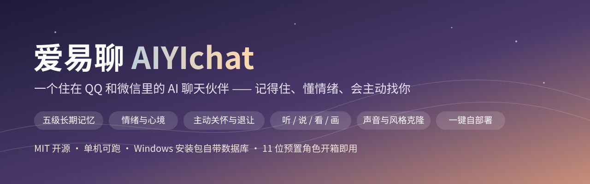
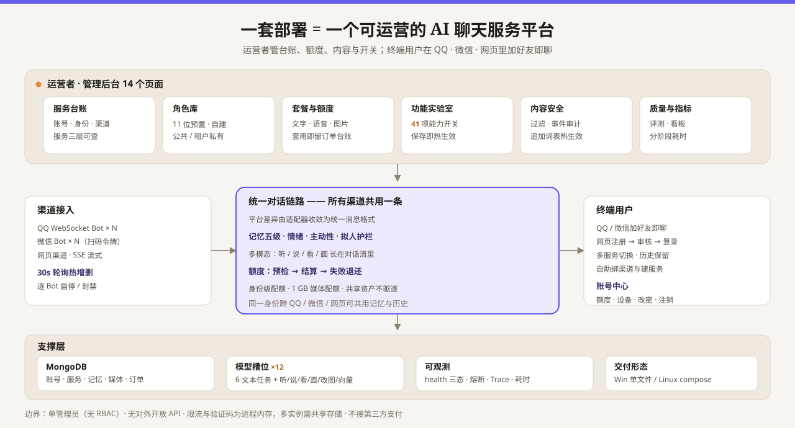

<p align="center">
  <a href="README.md">中文</a> · <strong>English</strong>
</p>

<p align="center">
  
</p>

<p align="center">
  <a href="https://github.com/BugWhispererChen/AIYIchat/releases/tag/v1.0"></a>
  <a href="LICENSE"></a>
  <a href="https://www.python.org/"></a>
  <a href=".github/workflows/ci.yml"></a>
  <a href="https://github.com/BugWhispererChen/AIYIchat/stargazers"></a>
  <a href="https://github.com/DasterProkio/awesome-ai-companion"></a>
</p>

# AIYIchat (爱易聊)

> **A self-hosted platform for running AI chat services.** Deploy it once and you get: multi-channel
> access (QQ / WeChat / web), N bots online at the same time, a billable service ledger
> (account → identity / channel → service), a persona and meme content library, quotas and plan
> templates, a full self-service account lifecycle for end users, content-safety auditing,
> an offline quality-evaluation harness and built-in observability.
>
> What sits on the other end, for the person actually typing, is **an AI companion living inside QQ
> and WeChat** — it remembers what you told it, reads your mood, and reaches out first. It understands
> your voice notes, looks at your photos, replies in a voice it learned from you, and sends the right
> meme at the right moment. 11 preset companion personas out of the box — or the one you build yourself.

**Operators don't need a team**: MIT licensed, one person and one machine is enough to run the service
and keep it running. Windows is a double-click installer that ships its own database; Linux is one script.
Install it and you already have 11 personas and a full meme library, ready to serve people.
**Users don't install anything**: add a friend on QQ or WeChat and the conversation starts.

> Most products in this space spend their effort on "a stronger model". AIYIchat bets on two things instead:
> **the feeling of being accompanied comes from the layers around the model** — how memory is retained,
> how a mood is caught, when to speak up, when to stay quiet, how one reply should be split into several
> messages; and **whether a service can be operated long-term depends on the unglamorous parts** — quotas,
> review, evaluation, observability — being built in rather than left as an exercise.
> If that framing interests you at all, **a Star is the most direct way to support this project**.

---

## 30 seconds of it

This is what the platform delivers to a human. Below is an **illustrative exchange** — written to show
what the system does, not a real user transcript. It shows what one and the same sentence looks like
when there is memory behind it:

```text
Them    Interview's done. Went badly, I think.
AI      Wait — the one you spent two weeks preparing for?
AI      Don't sentence yourself yet. Which part got away from you?
Them    I blanked on the project details at the end
AI      The one you walked me through the data flow for last week?
AI      Going blank in an interview is normal. It doesn't mean you weren't ready.
AI      (voice note 0:04)
AI      [meme: pat-on-the-shoulder.gif]
AI      Drop it for tonight. Go eat something hot. Come back and vent to me if you want.
```

Four things happen at once: **the mood is caught before anything is analysed**, **last week's detail is
retrieved**, **the reply switches to voice**, **a meme lands by tone**. On the operator side, all that was
required was configuring this persona's **character sheet, voice, meme groups and quota plan** —
everything downstream is the shared pipeline.

---

## Contents

1. [Highlights](#highlights)
2. [The platform side (B2B)](#1-the-platform-side-b2b)
3. [The companion side (C-end)](#2-the-companion-side-c-end)
4. [Quick start (V1.0 packages)](#3-quick-start-v10-packages)
5. [Tech overview](#4-tech-overview)
6. [Honest caveats](#honest-caveats)
7. [Contributing](#contributing)
8. [Compliance and responsibility](#compliance-and-responsibility)
9. [Asset credits](#asset-credits)
10. [Roadmap](#roadmap)
11. [Disclaimer](#disclaimer)
12. [Security disclosure](#security-disclosure)
13. [License](#license)

---

## Highlights

<p align="center">
  
</p>

### For operators (the platform side)

| What you get | What it actually is |
|---|---|
| **Service ledger** | Three layers: account → identity / channel → service, where **service = identity × channel × persona**; quota and memory ownership always reconciles |
| **Many bots at once** | QQ multi-bot + WeChat multi-account + web channels coexisting, hot add/remove on a 30-second poll, per-bot stop and block |
| **Metered quotas** | Text billed in tokens, voice per call, images per piece; apply a plan template in one click and it writes an order ledger with 30-day revenue |
| **Content library** | 11 preset personas + wizard-built ones + cloning, with public / private visibility; meme groups managed and bound per persona |
| **A site, if you want one** | Registration review, image captcha, per-IP rate limiting, login lockout, session concurrency governance, account centre, cascade hard delete on account closure — all built in |
| **Measurable quality** | Offline evaluation: LLM-as-a-judge + deterministic metrics + A/B pairwise comparison, so "better" is a number rather than a vibe |
| **Readable operations** | Three-tier health checks, circuit-breaker state, per-stage latency, trace IDs, metrics dashboard; config hot-reload without restarting the container |
| **Affordable to run** | Single-machine deployment; the Windows installer bundles the database and audio toolchain; edits take effect live; MIT means you can audit and patch it yourself |

### For end users (the companion side)

| What you get | What it actually is |
|---|---|
| **Nothing to install** | Add a friend on QQ or WeChat and chat; two platforms, one system, many bots and accounts online together |
| **Actually remembers** | Five memory tiers: deposit → semantic retrieval → hygiene de-duplication → reflection → relationship graph. That small thing you mentioned last week is still there today |
| **Initiative with manners** | It will come find you at a reasonable moment, and it backs off when ignored; do-not-disturb windows are configurable, personas keep their own daily routine |
| **Human, not model-shaped** | A deterministic "AI-tell" gate before sending, replies split at human typing rhythm, never three paragraphs when one line will do |
| **Four senses wired in** | Hears voice notes, reads photos, replies in audio with a preset or your cloned timbre, draws you a picture when the moment calls for it |
| **Swap personas freely** | 11 preset companions + build one in the admin wizard + import your own chat history and audio to clone one (words *and* voice) |

---

## 1. The platform side (B2B)

This section answers "can I actually provide a chat service from this, long-term". Everything below maps
to real code in this repo; the [Honest caveats](#honest-caveats) section states what is **not** here, so
the README doesn't become a source of wrong expectations.

### 1.1 The service ledger: account → identity / channel → service

Operability starts as a data model. The admin console's account page shows all of it on one screen,
searchable by username / bot / status:

| Concept | What it is in the system | Why an operator needs it |
|---|---|---|
| **Account** | A login-able, billable operating subject | Who is using it, who is out of quota, who gets deleted — all keyed here |
| **Identity** | Who the AI is inside that relationship; the ownership unit for memory and quota | Swapping persona doesn't mean re-onboarding; an identity can be flagged as a minor to enable protections |
| **Channel** | One QQ credential set, one WeChat bot token, or one web channel | Adding a channel never touches the engine; records distinguish admin-created from user-scanned |
| **Service** | The triple **identity × channel × persona** | Decides "which entry point, whose personality, whose quota" a conversation runs on |

One identity can be hung on a shared group so that QQ, WeChat and web **share memory and history** —
the person sees the same "someone" across all three entry points — while a unique constraint keeps one
channel from hosting conflicting services. **Quota is charged per account, memory is stored per service.**
Keeping those two ownership axes separate is what makes billing, auditing and deletion possible at all.

### 1.2 Multi-channel concurrency: N bots on one machine

- **Three channel kinds coexist**: QQ (WebSocket, `app_id` / `app_secret`, sandbox mode supported),
  WeChat (`bot_token` + context token + expiry), and web channels (SSE streaming). Platform differences are
  collapsed by adapters into **one normalised message format**, after which every channel shares
  a single conversation pipeline.
- **Hot add / remove**: the QQ bot manager polls MongoDB every 30 seconds and only starts bots referenced by
  an active service — adding or retiring a bot doesn't restart the container. The WeChat manager only starts
  accounts that are online and not blocked.
- **Per-bot handling**: stop, toggle and block any single bot from the console without touching the others.
- **No dropped segments**: when one inbound message carries text + image + voice as multiple parts,
  none of them overwrite each other; all are stored and reviewable.
- **Adding a channel** means implementing the adapter's normalised message interface — **not editing the engine**.

### 1.3 Model supply: 12 task slots over reusable credential groups

Models are not one global setting. Each task points at a reusable credential group (name + `base_url` +
`api_key` + default model):

| Slots | Used for | Independently tunable |
|---|---|---|
| **6 text tasks** | chat / proactive outreach / fact extraction / emotion labelling / summarisation / clone analysis | `temperature`, `max_tokens`, `timeout` |
| **6 capability slots** | ASR, TTS, vision, image generation, image editing, embeddings | each takes its own credential group |

- **Switching vendors = editing one group.** Text tasks go to any OpenAI-compatible endpoint
  (Alibaba Bailian / DeepSeek and similar) without affecting the rest: emotion labelling runs
  `temperature 0.0 + 128 tokens`, chat runs `0.85 + 2048`, extraction gets a larger budget so JSON isn't truncated.
- **Credentials never surface.** The console and the APIs report only "configured or not"; keys don't render,
  aren't logged and never enter the conversation context.
- First boot turns a single `DASHSCOPE_API_KEY` into 5 default config groups — you can run it with zero setup.

### 1.4 41 capability toggles, hot-applied

The console's feature lab packs **41 capability toggles** plus numeric parameters (time windows and meme
probability, voice window, rhythm limits, memory and graph, the streaming gate) onto one page.
Models, channel credentials and toggles **all live in the database**.

- **No container restart.** Triggering a reload from the console also resets the provider / vision /
  embedding / safety / graph clients.
- **Upgrades don't stomp on operator config.** Anything you changed in the console keeps winning over the
  code defaults after an upgrade.
- **Safe to gray-release.** The anthropomorphic streaming gate and friends default to off, and behaviour
  before they're enabled is **byte-identical** to before. When something misbehaves you flip one switch —
  you don't roll back a deployment.

### 1.5 Quotas, plans and the order ledger: a service you can price

| Piece | How it actually works |
|---|---|
| **Plan template** | Four fields — text tokens / voice calls / image pieces / validity days — CRUD in the console |
| **Applying it** | One click per account: writes the quota **and** records an order entry; the console shows last-30-day revenue |
| **Text billing** | **Pre-check first, settle after**: estimated over the whole prompt plus `max_tokens` × (3 when function calling is on), then settled against real usage |
| **Voice / image** | Charged per synthesis, **refunded on failure**; if image quota runs out the picture is dropped instead of failing the whole reply |
| **Proactive messages** | A read-only quota pre-check runs before sending, so **the system never keeps spending external money after quota is exhausted** |
| **Trial quota on signup** | Defaults to 200,000 tokens / 30 voice calls / 20 images / 30 days; can be re-pointed at a free-quota template |
| **Media quota** | 1 GB per account; over quota evicts the account's own oldest media and detaches references, while **shared memes, public persona portraits and history referenced by others are never evicted** |

Deduction is a conditional atomic update (used + amount ≤ limit and not expired). A separate "allow
overage" path exists so an under-estimated pre-check can't be farmed. **There is no payment provider wired
in** — the order amount is a manually typed bookkeeping figure; see [Honest caveats](#honest-caveats).

### 1.6 Persona and content library: platform personas plus tenant-owned ones

- **Out of the box**: 11 preset personas (a main companion + five girlfriends + five boyfriends) seed
  themselves at startup, each with differentiated character sheets, language style and personality
  dimensions, bound to a different official timbre and shipped with a portrait.
- **Build your own in the wizard**: name and description → the model drafts character sheet / language
  style / dialogue strategy → upload or generate a portrait → pick a voice → preview → confirm.
- **Two visibility levels**: public personas act as the platform catalogue, private ones belong to one
  account — so **the operator maintains shared personas while tenants keep their own**, and one bot can
  present a different personality to different users.
- **Sectioned, editable character sheets**: persona / language style / personality / dialogue strategy /
  **time-of-day routine** / reply-length bias / bound meme groups / cloned timbre.
- **Meme library**: group CRUD, per-item enable / disable and delete, ownership assignment, uploads;
  built-in assets are imported idempotently by file hash at startup.
- **Voice cloning**: upload a clip to register a private timbre, preview it or clear it, and use it for
  voice replies directly.
- **Style cloning**: import your own chat history → asynchronous chunked analysis of tone, vocabulary and
  rhythm → poll the job → preview → save as an editable profile. A dedicated **clone-feedback** review page
  supports human review, and clone quality has its own scoring script and sample set.

### 1.7 The end-user account lifecycle: everything you need to open a site (off by default, two switches to on)

Every gate a person passes from signup to deletion is built in, with thresholds an operator can change:

```text
register → username and weak-password validation → image captcha → per-IP sliding-window limit
         → admin review (or instant approval) → login (failure lockout)
         → session concurrency and sliding expiry → self-service channel binding / service creation
         → account centre (password · devices · quota · export) → account closure (cascade hard delete)
```

- **Credential strength**: usernames 3–32 characters and past a reserved-name list; passwords 8–64
  characters, must mix letters and digits, must not contain the username, and must clear a blacklist of
  roughly a hundred weak passwords.
- **Abuse resistance**: arithmetic image captcha (300-second TTL, single use); per-IP sliding-window limits
  defaulting to 5 register / 20 login attempts per window; a rejected username can't be re-registered for 24 hours.
- **Review**: registration requires admin approval by default; a toggle switches to instant approval
  (recording a system review marker).
- **Session governance**: 5 failed logins lock the account for 15 minutes; at most 3 concurrent sessions,
  evicting the oldest device, with 24-hour sliding renewal.
- **Self-service**: users add their own QQ / WeChat / web channels (scan to bind credentials), create several
  chat services (service = identity × channel × persona), switch per service in the chat page while keeping
  history and media, and use in-browser voice input with persona-voiced replies —
  **the operator doesn't have to provision anyone by hand**.
- **Compliance trail**: registration forces a "I am at least 14 years old" confirmation; terms and privacy
  versions plus acceptance timestamps are stored; an identity flagged as a minor gets protection prompts
  injected into the pipeline and blocked attempts recorded as events.
- **Deletion really deletes**: a cascade hard delete across 11 collection families, credentials first,
  with a pre-scan that runs before any removal.
- **Caps**: per-account limits on how many personas (5) and services (3) one may create, tunable in the console.

### 1.8 Content safety and observability: legible when things go wrong, verifiable after a change

**Quality evaluation — measure before you touch a prompt, compare after**

- Offline evaluation CLI: LLM-as-a-judge scoring on 5 dimensions (persona consistency, empathy, memory
  accuracy, naturalness, boundary honesty) plus deterministic metrics (length distribution, blocking
  AI-tell hits, memory consistency, warmth, temporality).
- **GSB pairwise comparison**: the same turn is fed to the pre-change and post-change version and judged
  Good / Same / Bad; a baseline drops to JSON and compare mode renders the verdict. It can act as a release
  gate (non-zero exit) — deliberately kept out of CI so it can't burn model quota — and a dry-run mode
  executes cases with no database and no model calls.
- Cloning is judged separately: blind pairwise style preference with **bootstrap confidence intervals**
  plus privacy-leak detection. A zero-model memory-hygiene stat script and a reply-length report over
  real traffic round it out.

**Operations and observability**

- Three-tier health endpoints (`/api/health`, `/api/health/live`, `/api/health/ready`): database ping, LLM and
  circuit-breaker state, embedding degradation, disk watermark, background task slots. Latency, disk and
  raw exception text are returned **only to an admin session** — this is a public repository.
- Circuit breaker: failure-rate threshold trips it, a recovery window opens, a success count closes it,
  so one slow vendor can't drag the whole pipeline down.
- **Per-stage latency instrumentation**: identity resolution / context / emotion / semantic recall /
  prompt build / LLM / settlement / media are each timed, with pre-LLM and whole-turn totals; `X-Trace-ID`
  spans the request. A "83 seconds for one turn" incident was located in the vector-recall stage by exactly
  this line; first-turn-after-restart went from **88.1 s to 6.4 s** — again, measurement before courage.
- Content safety: filter and audit event ledger, last-7-day crisis / forbidden / minor-block counts,
  **operator-added keyword lists that apply hot**, security response headers.
- Metrics dashboard: CPU / memory / disk / connections, 14-day message and average-latency trend,
  7-day emotion distribution, refreshed by partial polling.
- Backups are a cron-invoked `mongodump` script (7 rolling copies) rather than something in the request path.

---

## 2. The companion side (C-end)

### 2.1 Memory: five tiers, not "stuff more into the context window"

Ordinary chatbots forget the moment you stop typing. AIYIchat makes memory a chain you can inspect level
by level, where each level can be toggled and evaluated on its own:

| Tier | What it does | What you feel |
|---|---|---|
| **① Deposit** | Rolling history window plus automatic summarisation as it grows, writing key points as facts | "It still remembers that small thing I mentioned offhand last week" |
| **② Retrieval and layered injection** | Stable facts stay in the system-prompt prefix to hit cache; this turn's semantic recall is injected after | It understands you better as you talk, and stays fast |
| **③ Hygiene** | Normalises how people are referred to so one thing isn't re-recorded as a new fact; point-in-time events like "interview tomorrow" stop being mentioned once past | Memory doesn't get dirtier with use, and it won't misquote stale facts |
| **④ Reflection** | Once facts pass a threshold they're condensed into higher-level insights, each traceable to at least two facts, revocable one by one in the memory page | It doesn't just keep fragments — it concludes "you've been under a lot of pressure lately" |
| **⑤ Relationship graph** | Optional embedded graph database for "who is related to whom"; falls back to a one-hop query when off, without feature loss | It can string together your friend's name and your mother's job |

Tier ② was learned the hard way: semantic recall computes a query vector on the spot, and a slow embedding
service once ate over a minute. The whole recall path now runs under one timeout budget with a breaker
(**a slow success still counts as a failure**); on timeout it drops only this turn's semantic recall,
injects the stable tier, and **never blocks the conversation**.

### 2.2 Emotion: catch the mood before composing the sentence

Each inbound message is classified for emotion across 11 labels, and the signal feeds both the prompt and
the emotional parameters of a voice reply — gentle when you're low, playful when you're up, with a tone in
the audio that matches the words.

Two details keep it from feeling like a tool:

- **It doesn't guess at short messages**: "mm", "oh" and other contentless messages below a character floor
  skip the extra model call, rather than inventing a psychological reading of one interjection.
- **Reaction before analysis**: when you share good news or vent, the first thing you get is an emotional
  reaction, then questions — not an immediate diagnosis.

### 2.3 Proactivity: it reaches out, and it also knows when to stop

The proactive scheduler picks moments from conversation history and time awareness — it isn't a cron blast:

- **Do-not-disturb windows** are configurable per service and per identity, so it won't ping you at 3 a.m.
- **It backs off**: after a few unanswered proactive messages it stops sending and records why — no "AI
  chasing you asking are you there" awkwardness.
- **Proactive content isn't just "drink water"**: recall triggers can be replaced, by ratio, with real
  material — fetching the day's topics and rewriting them in character, or inventing a universally amusing
  tidbit (fabricating current events is explicitly banned). If the fetch fails it degrades to the tidbit:
  **say less rather than invent news**.
- **Personas keep a routine**: schedule, time-of-day and reply style are coupled, so a persona that "just
  went running" won't instantly reply at 3 a.m.
- **Operators can see it all**: the proactive page configures time windows, the yield threshold and the
  sharing ratio, filters sent records by status, summarises the last 7 days, and prunes by retention days.

### 2.4 Human-likeness: deterministic guardrails, not hoping the model behaves

Prompting alone doesn't make an AI feel human. AIYIchat puts a set of **zero-model-cost** deterministic
rules into the send path:

- **Clean before release on the streaming path**: with SSE streaming on the web, the old order was
  token-by-token passthrough with all anthropomorphic cleaning applied afterwards — meaning the user saw
  everything dirty and only the stored copy was clean. Cleaning now happens **before** the gate releases, so
  **every character on your screen is the character that got stored** (a half-formed marker like
  `[meme: a hug]` can't leak). The price is roughly 0.3–1 s of time-to-first-token, a tradeoff the product
  side signed off on: slower rather than out-of-character.
- **A Chinese "AI-tell" gate before sending**: deterministic regexes scan for giveaways like "Sure, I can
  help with that!", "In summary", "I hope this helps" and remove the offending sentence on hit. The rule set
  was rewritten with reference to community open-source tooling, and each rule has test cases proving it
  doesn't over-delete.
- **Rhythm and splitting**: a long reply is split into several short messages at human typing rhythm instead
  of dumping a wall of text; reply length has both governance and a reporting metric.
- **Echo and loop detection**: a new reply too similar to the last two triggers regeneration; several turns
  spinning in place prompt a topic change — not left to the model's self-discipline.

### 2.5 Multimodal: all four paths live inside the conversation, not bolted onto an endpoint

| Sense | Effect |
|---|---|
| **Hearing** (ASR) | Send a voice note and it understands; the transcript runs down the same conversation pipeline |
| **Speaking** (TTS) | Voice replies in a preset official timbre or the private one you cloned |
| **Seeing** (Vision) | Photos are understood by content — including the image inside a meme |
| **Drawing** (ImageGen) | Generates an image from conversational context on demand, and can edit images too |

Plus three details that do most of the "human" work:

- **Voice cloning**: upload one audio clip to register a private timbre and use it for voice replies —
  **the words match and the voice matches too**.
- **A drifting voice window**: after you send a voice note and it answers in voice, that conversation stays
  in a randomised window (5–30 minutes by default) where **it keeps replying in voice even if you switch
  back to typing** — like two people who drift into voice messages, not a toggle you flip each turn.
- **It can meme-fight**: the built-in meme library is matched by semantic vectors and **it prefers saying
  nothing over a mismatched meme**; it will throw one when the mood fits, and if you send only a meme it
  answers with a picture probabilistically. Meme groups can be bound to different personas.

### 2.6 If the console can see it, you can hand it to someone else

The conversation page paginates, searches and can delete a single message; the memory page shows, per
service, the topic threads / facts / open follow-ups, **which memories were injected into this turn**
(injection snapshots) with hit-rate and usefulness metrics, and lets you revoke entries one at a time.
An operator can answer "why did it say that" without reading source.

---

## 3. Quick start (V1.0 packages)

**Grab V1.0 from the [Releases page](https://github.com/BugWhispererChen/AIYIchat/releases/tag/v1.0)**,
or build from source with option 3 below. Either way you only need two things:
**an Alibaba Bailian (DashScope) API key** — shared by text, voice and image — and **an admin password**.

| Artifact | For | Size | SHA-256 |
|---|---|---|---|
| `AIYIchat_Setup_v1.0_20261101.exe` | Windows 10 / 11 x64, single machine, small operation | ~110 MB | `f9f3f66775a6b310ea162c1b0548919a7d8485edef072b83e28a9b066357ece2` |
| `aiyichat-deploy-v1.0-20261101-linux.tar.gz` | Server / NAS / Docker, public-facing service | ~11.6 MB | `d5853bab941ab70c66a7267605c888fa9137c0742c527e22115c0c99a1a8f16d` |

> Verify (PowerShell): `Get-FileHash .\AIYIchat_Setup_v1.0_20261101.exe -Algorithm SHA256`
> Verify (Linux): `sha256sum aiyichat-deploy-v1.0-20261101-linux.tar.gz`
> Binaries aren't distributed through Git (size; excluded in `.gitignore`) — they live on the Release only.

### Option 1 — Windows installer (best if you don't want a command line)

1. Double-click `AIYIchat_Setup_v1.0_20261101.exe`; installation needs admin rights, and "start on boot" is
   optional. The installer bundles the database (registered as a Windows service, listening on `127.0.0.1`
   only), the audio transcoding toolchain and an HTTPS certificate — **no Docker, Python or MongoDB required**.
2. Edit `AIYIchatService\.env` in the install directory (under `Program Files` by default) and set
   `DASHSCOPE_API_KEY`.
3. Launch the AIYIchat service panel (desktop shortcut). It **starts the service automatically**; the panel
   shows status, database connection, uptime, URLs and CPU / memory with a scrolling log, and minimises to
   the tray when closed. After editing `.env`, press Stop then Start.
4. **Admin password**: if `ADMIN_PASSWORD` in `.env` is empty or still the template value, the first boot
   generates a random strong password and **prints it in the panel log once** — copy it immediately.
5. Open `https://localhost:8443/admin/login` (or click "Open admin console" in the panel; Windows defaults to
   port **8443**, unlike Linux's 443). The self-signed certificate will warn — choose Advanced → Continue.
   LAN IPs are already in the certificate SAN, so other devices on the same network can use this machine's IP.

Uninstalling asks whether to delete the database data (chat logs, personas and other business data);
choosing No keeps it, and a reinstall continues where it left off.

### Option 2 — Linux package (server / production)

```bash
tar -xzf aiyichat-deploy-v1.0-20261101-linux.tar.gz
cd aiyichat-deploy-v1.0-20261101-linux

cp .env.example .env      # set DASHSCOPE_API_KEY and ADMIN_PASSWORD
chmod +x deploy.sh
./deploy.sh               # HTTPS 443 + HTTP 80 (redirects to HTTPS), self-signed cert generated on first run
# ./deploy.sh --https-port 8443 --http-port 8080    # custom ports
```

Requires Docker 20.10+, Docker Compose 2.0+, 2 GB+ free memory.
Then open `https://<host>/admin/login` (append the port if you changed it).

### Option 3 — From source with Docker Compose

```bash
git clone https://github.com/BugWhispererChen/AIYIchat.git && cd AIYIchat/aiyichat
cp .env.example .env      # same two variables
docker compose up -d --build
docker compose logs --tail=50 app
```

The self-signed certificate is prepared in that step (a one-shot `certgen` service runs
`tools/ensure_certs.py` before the app starts) — no manual openssl. If you place real certificates in
`certs/`, they are detected and left alone. To reach it by LAN IP rather than `localhost`, put that address
into the certificate's subject alternative names:

```bash
CERT_EXTRA_HOSTS=192.0.2.20 docker compose up -d --build
```

A container can't discover the host's LAN address, so this has to be explicit, otherwise the browser
reports a name mismatch when opened by IP.

### The three things to do after install

1. **Set the key**: first boot derives 5 default model config groups from `DASHSCOPE_API_KEY`
   (text / text-to-image / speech synthesis / embeddings / image editing). Change models or vendors later in
   the console's AI model page — saving applies hot.
2. **Add friends**: console → account detail → channel management. QQ binds by scanning a code, WeChat by
   QR login; credentials are stored in the database and hot-loaded, **no local config files at all**.
3. **Chat**: the 11 personas and the meme assets are seeded at startup, so binding a persona is enough.

The 14 console pages cover: dashboard, accounts, conversations, proactive outreach, memory, billing,
web accounts, personas, persona cloning, memes, AI models, feature lab, content safety, change password —
plus config hot-reload.

The C-end web app (optional, off by default): flip the switch on the web-accounts page, then visit
`/web/register`, `/web/login`, `/web/chat`, `/web/services`, `/web/account`. While the switch is off,
those routes and their APIs refuse anonymous access.

Full environment-variable list, directory layout and troubleshooting (port conflicts, certificate trust,
logs, database backup, restarts) live in [aiyichat/README.md](aiyichat/README.md).

---

## 4. Tech overview

Python 3.11 + FastAPI (fully async), MongoDB (async driver + repository layer), Docker Compose for a
single host; model calls go through OpenAI-compatible APIs (Alibaba Bailian / DeepSeek and others are
swappable). The admin console is server-rendered with partial updates — **no frontend build chain**.
Platform differences (QQ WebSocket, WeChat iLink) are collapsed by adapters into one normalised message
format, after which every channel shares the same conversation pipeline.

The full stack, request path diagram, directory responsibilities, data model and key design tradeoffs are
in **[docs/ARCHITECTURE.md](docs/ARCHITECTURE.md)**.

---

## Honest caveats

Written so this README can't create a wrong expectation. **What is genuinely not here:**

- **No QQ or WeChat outside China.** The channels that carry this product are the two dominant Chinese
  messaging apps. International readers will most likely only use the web channel.
- **You must bring your own model key**, and the voice path is vendor-bound. Text tasks can be re-pointed at
  any OpenAI-compatible provider per task, but cloned timbres belong to the provider doing the synthesis, so
  switching vendors means re-cloning voices.
- **Single admin, no roles.** The console is one admin credential plus an in-process session: no multiple
  admin accounts, no permission tiers, no "who changed this" audit. The order ledger's operator field is
  fixed to admin today.
- **No public API or webhook for third parties.** `/api/*` are cookie/session-authenticated C-end endpoints;
  there is no API-key system, and production also disables the interactive docs and OpenAPI schema.
- **No payment integration.** Plan templates, quotas and the order ledger are bookkeeping. Collecting money,
  renewals and invoices are yours to wire up outside.
- **Rate limiting, captcha, admin sessions and login-failure counters are in-process memory.** They clear on
  container restart, and **with multiple instances (horizontal scaling) each instance counts separately, so
  limiting and captcha validation stop working** — move them to shared storage (e.g. Redis) before
  opening multi-instance registration.
- **Toggle granularity is global plus per-persona.** There is no per-service or per-channel capability switch.
- **No white-labelling.** Brand and site name are fixed in source; rebranding means editing templates and
  startup config.
- **All persona content is Chinese**, presets and prompts alike.
- **The preset memes come from an open-source dataset** (see [Asset credits](#asset-credits)). You can disable
  items and replace them with your own, which is not the same as obtaining commercial rights.
- **Proactive messages only reach QQ and WeChat** today; a push channel for web accounts is still planned.

---

## Contributing

Issues and PRs are welcome — so is fixing a typo in this README.

- **Ideas / bugs**: [issue templates](.github/ISSUE_TEMPLATE) (separate templates for bugs and features).
  Strip server addresses, keys and usernames before pasting logs — this is a public repository.
- **Local development**:
  ```bash
  cd aiyichat
  python -m venv .venv && .venv/Scripts/pip install -r requirements-dev.txt
  .venv/Scripts/ruff check app tools      # lint
  .venv/Scripts/mypy app                  # types
  python tools/test/run_tests.py          # test suite
  ```
- **Before committing**: read [CONTRIBUTING.md](CONTRIBUTING.md) (commit format `<type>: <summary>`,
  the sensitive-information pre-commit scan, dependency vulnerability audit). Never put server addresses,
  credentials or internal paths into code or docs in this public repo.
- **Want to add a channel or a model?** A channel only needs to implement the adapter layer's normalised
  message interface; a model only needs a credential group in the console. Neither touches the engine.

> If "companionship comes from around the model, and platform capability should be built in" sounds like an
> interesting bet, **give it a Star** so more people on GitHub can find it; to follow releases, hit **Watch**
> or bookmark [Releases](https://github.com/BugWhispererChen/AIYIchat/releases).

---

## Compliance and responsibility

This is an open-source technical project. The **deploying party** (the individual or organisation actually
running it) carries these obligations:

- **Generative-AI service filing**: offering this to the public requires algorithm / large-model filing under
  China's Interim Measures for the Management of Generative AI Services.
- **Content-security responsibility**: the deployer is accountable for filtering and auditing generated
  content (review is built in; the legal duty is still yours).
- **Minor protection**: this project includes emotional-companion personas, so the deployer must state usage
  restrictions for minors prominently. With C-end registration enabled, the signup page forces an "I am at
  least 14 years old" confirmation and refuses under-14 signups, storing the confirmation together with the
  terms / privacy version; assess any additional statutory duties for serving minors yourself.
- **Registration review and abuse controls**: registration requires admin approval by default, protected by
  image captcha and a per-IP sliding-window limit, and a rejected username cannot be re-registered for 24
  hours. Public services should retain review and action records to discharge content-security duties.
- **Deployment-form limits**: rate limiting and captcha are **single-instance in-memory** and clear on
  restart; with multiple instances each counts independently, so both stop working until you move them to
  shared storage (e.g. Redis) before opening multi-instance registration.
- **Reverse-proxy requirement**: rate limiting counts client IPs. Direct deployment uses the TCP peer address;
  trust proxy headers only once your proxy layer **overwrites** `X-Forwarded-For` with `$remote_addr`. It is
  off by default so a client cannot forge a header and bypass limits.
- **No unlawful use**: this project must not be used for fraud, harassment or violating others' privacy.

---

## Asset credits

- **Preset memes** (`aiyichat/data/stickers/`): from the [ChineseBQB](https://github.com/zhaoolee/ChineseBQB)
  open-source meme dataset. Most material is internet-famous imagery with possible original-author rights;
  assess commercial use before shipping. If there is an objection, items can be disabled or deleted one by one
  in the console's meme management page and replaced with your own assets. See [NOTICE.md](aiyichat/data/stickers/NOTICE.md).
- **Preset persona portraits** (`aiyichat/data/preset_portraits/`): generated by the project's own image
  service from prompts in the seed script — not real people, not third-party material.
  See [NOTICE.md](aiyichat/data/preset_portraits/NOTICE.md).
- **Third-party components bundled in the Windows installer** (audio transcoding tool and database server):
  their licence notices are in `THIRD_PARTY_NOTICES.txt` inside the installer.
- **README hero image** (`assets/readme/hero.svg`) and **platform architecture diagram**
  (`assets/readme/platform.svg`): hand-made vector figures produced by this project, containing no
  third-party material.

---

## Roadmap

### Done (V1.0)

**Platform side**

- QQ + WeChat ingestion with multi-bot / multi-account concurrency, hot add/remove, per-bot stop and block
- Three-layer ledger: account → identity / channel → service (service = identity × channel × persona),
  with memory and history shared across channels
- 12 model task slots over reusable credential groups, per-task vendor switching, masked credentials
- 41 feature toggles and config hot-reload (upgrades don't overwrite operator settings)
- Plan templates and order ledger, per-account quotas (text tokens / voice calls / image pieces),
  pre-check with refunds
- Per-account media quota with shared-asset protection; streaming inbound media download with size caps
- Persona system: 11 presets, admin wizard, public / private visibility, chat-history style cloning and
  voice cloning
- Meme group management with semantic retrieval
- C-end web accounts: self-service registration (review / captcha / rate limiting / session governance) and
  account centre (password / devices / quota / export / account closure)
- C-end self-service channels and services (QQ / WeChat scan binding, multiple web channels, cross-channel
  continuation with history review)
- Content-safety filtering and event audit, minor-protection prompts and block trails, age confirmation with
  terms-version retention
- Observability: three-tier health checks, breaker state, error categorisation, per-stage latency logs,
  system metrics dashboard
- Offline conversation evaluation (LLM-as-a-judge + deterministic metrics + GSB pairwise, plus clone
  evaluation and privacy-leak detection)
- GitHub Actions CI (lint / types / tests)
- **V1.0 packages for both platforms**: a one-click Windows installer (bundled database and service panel)
  plus a Linux source package (one script, with automatic static verification and runtime smoke test
  after packaging)

**Companion side**

- Long-term memory with automatic summarisation; semantic retrieval with layered injection (stable facts
  stay in the prefix for cache hits, this turn's recall injected after)
- Memory hygiene and reflection (reference normalisation, expired point-in-time events dropped, traceable
  higher-level insights)
- Optional relationship-graph enhancement (auto-degrades when off, no feature loss)
- Emotion detection with emotion-aware replies; topic and mood management
- Proactive outreach: do-not-disturb windows, per-service and per-identity config, yielding when ignored,
  current-affairs and tidbit sharing (degrades gracefully when the fetch fails)
- Human-likeness pipeline: streaming **clean-before-release** (what you see is what is stored), the Chinese
  AI-tell gate, unified rhythm and splitting, reply-length governance, short-but-warm (reaction first when
  you share news or vent), persona routines, echo and loop detection
- Four multimodal paths (hearing / speaking / seeing / drawing) with the drifting voice window, browser voice
  input and AI voice replies, streaming delivery of images / memes / audio

### Planned (pick one up)

**Platform side**

- **Multiple admins and role-based permissions**, with operator action auditing
- **A public API / webhook surface** for third-party integration (auth and callbacks)
- **Shared rate-limit storage (Redis)** for multi-instance deployment
- **Online top-up and payment-provider integration** (today it is manual bookkeeping)
- Per-service / per-channel capability switches
- External alerting channels (currently only an in-console degradation banner)
- White-labelling and site brand customisation

**Companion side**

- More preset personas and marketplace-style persona management
- Colloquial post-processing and paired dialogue reference corpora
- A proactive-outreach push channel for web accounts (proactive messages are QQ / WeChat only today)
- Email / SMS self-service password recovery

---

## Disclaimer

All conversation content in this project is generated by artificial intelligence, for entertainment and
companionship only, and constitutes neither medical nor psychological advice. An AI companion is not a
substitute for human contact or professional mental-health services; if you are in emotional distress,
please contact a professional support service. Minors should use this under guardian supervision.

Persona cloning is restricted to your own chat history, and that data can be deleted at any time.

---

## Security disclosure

If you find a vulnerability, please report it privately through GitHub Security → Report a vulnerability,
rather than in a public issue. See [SECURITY.md](SECURITY.md).

---

## License

This project is released under the [MIT License](LICENSE).
